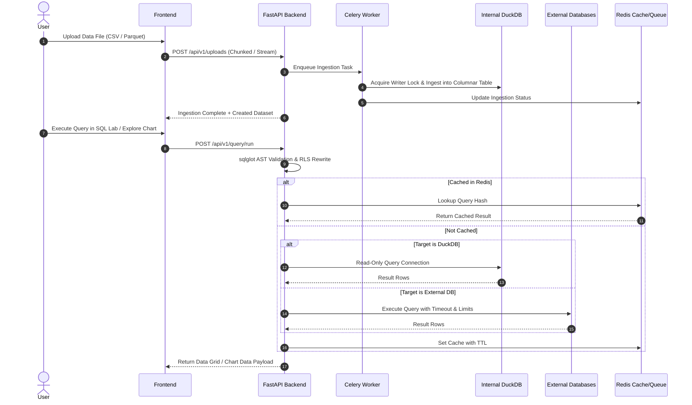

# Ask Your Data — System Architecture Document

## 1. Vision and Mission
**Ask Your Data** is an enterprise-grade business intelligence and analytics platform engineered with Apache Superset parity (database connectors, file uploads to an internal columnar store, semantic datasets with metrics/calculated columns, Monaco SQL Lab, and drag-and-drop dashboards) paired with a grounded, non-hallucinating AI data analyst.

## 2. Core Architecture Components

### 2.1 Backend (`/backend`)
- **FastAPI**: Provides asynchronous REST APIs, OpenAPI schema generation, and Server-Sent Events (SSE) streaming for long queries and AI reasoning.
- **SQLAlchemy 2.0**: Handles metadata persistence with async sessions (`asyncpg`) and manages a dynamic connection pool for external database engines.
- **Alembic**: Migration framework managing schema evolution for the PostgreSQL metadata database.
- **DuckDB**: Embedded analytical engine functioning as an internal high-performance columnar data store for user file uploads (CSV, TSV, Parquet, JSON, Excel).
- **sqlglot**: AST parsing, syntactic validation, dialect transpilation, safety checks, and Row-Level Security (RLS) query rewriting.
- **Celery + Redis**: Distributed task execution queue for asynchronous long-running queries, chunked multi-part file parsing, and automated reporting.
- **Pydantic v2**: Strict schema definition and runtime validation for all API inputs, outputs, and AI tool definitions.

### 2.2 Frontend (`/frontend`)
- **React 18 + TypeScript + Vite**: Single-page application configured with strict type-checking and modern bundling.
- **Tailwind CSS & shadcn/ui**: Modern, accessible UI design system supporting light/dark themes and dense enterprise data layouts.
- **Apache ECharts (`echarts-for-react`)**: High-performance canvas/SVG charting library supporting Tier 1 and Tier 2 analytical charts.
- **Monaco Editor**: Visual Studio Code-grade SQL editing environment with schema-aware autocompletion and syntax highlighting.
- **TanStack Query & Zustand**: Server-state synchronization, query caching, and client-side authentication/layout state management.
- **react-grid-layout**: Draggable, resizable, responsive dashboard layout manager with cross-filtering and native filter scoping.

## 3. Communication & Data Flow

## 4. Security Principles
1. **Zero Secret Leakage**: Database credentials stored at rest are encrypted via AES-128-CBC using Fernet symmetric encryption keys. Secrets are stripped from all API outputs.
2. **Safe SQL AST Execution**: No raw SQL concatenation anywhere in the codebase. Every query is parsed, validated, rewritten with RLS clauses, and assigned statement timeouts and limit clamps.
3. **Cookie-Based JWT**: Authentication tokens are stored exclusively in secure, `httpOnly`, `SameSite` cookies to protect against XSS token exfiltration.
4. **Air-Gapped AI Isolation**: The platform operates with 100% functionality when AI is disabled. When enabled, the LLM has zero direct database credentials; it queries strictly through validated tool wrappers.

